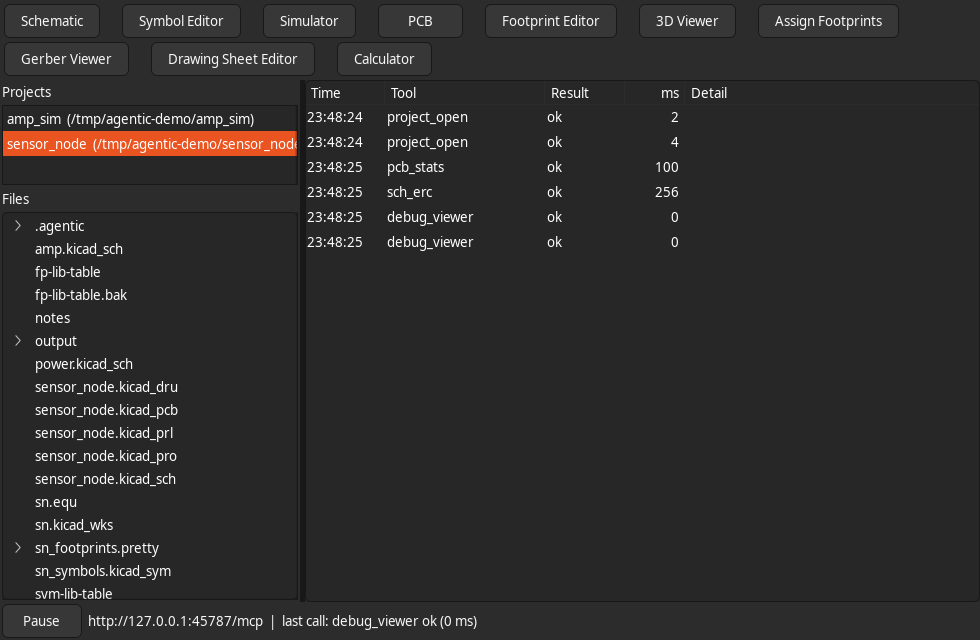
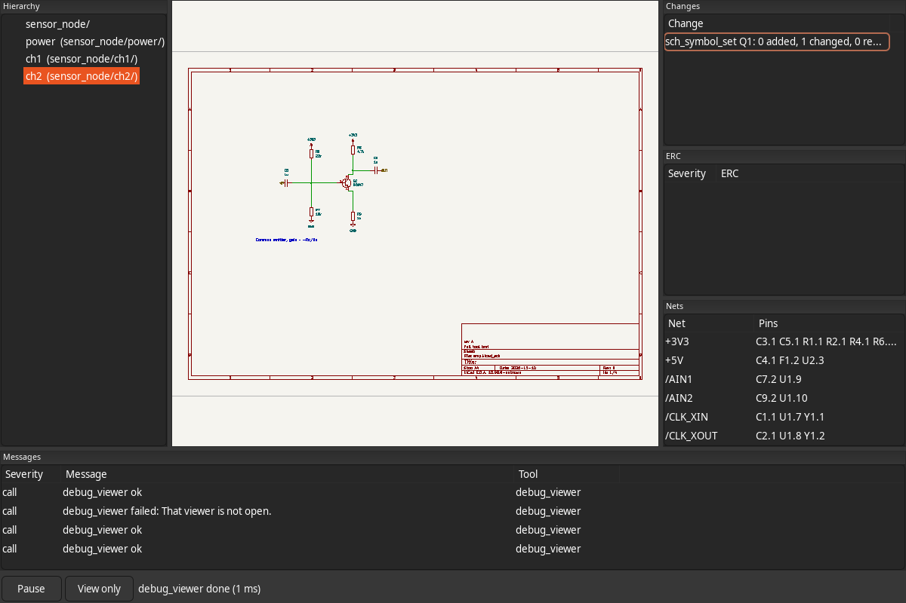
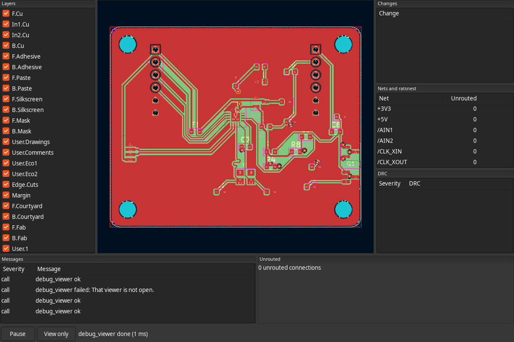
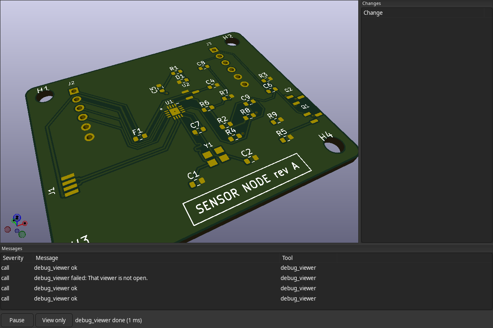
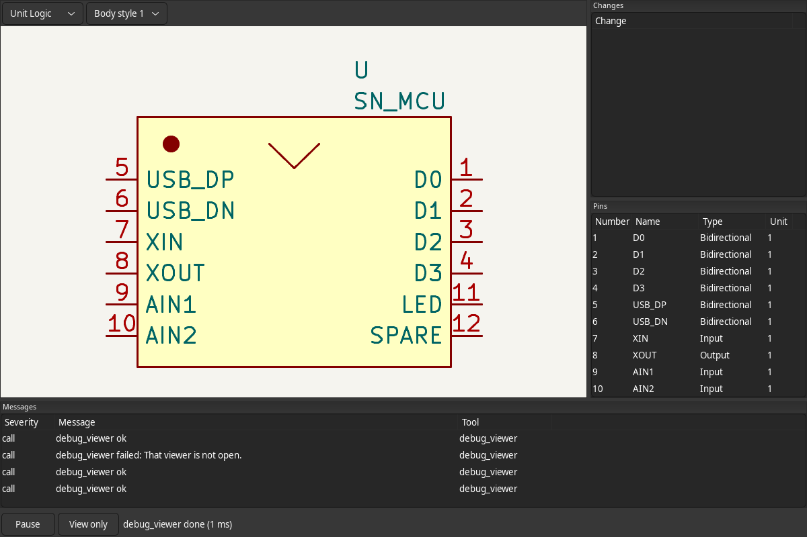
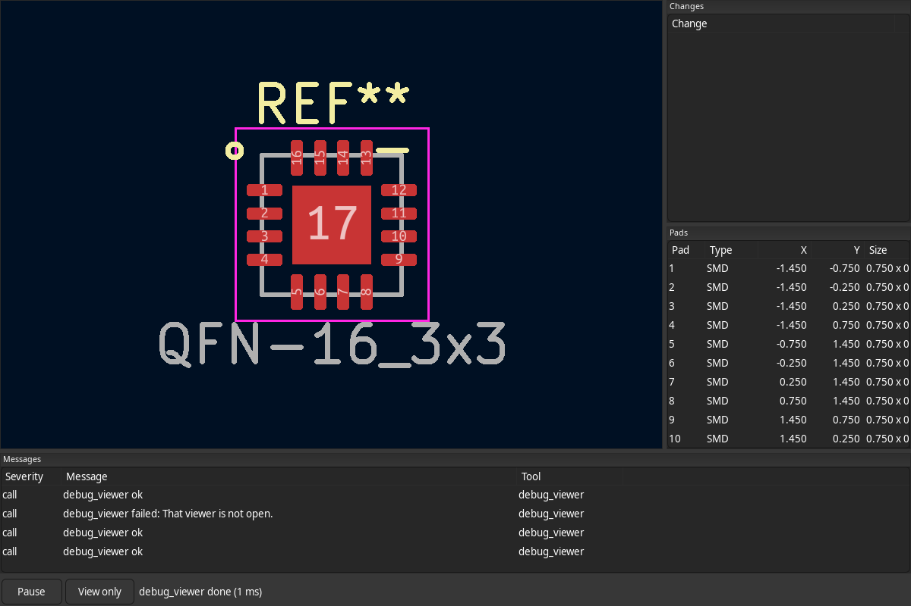
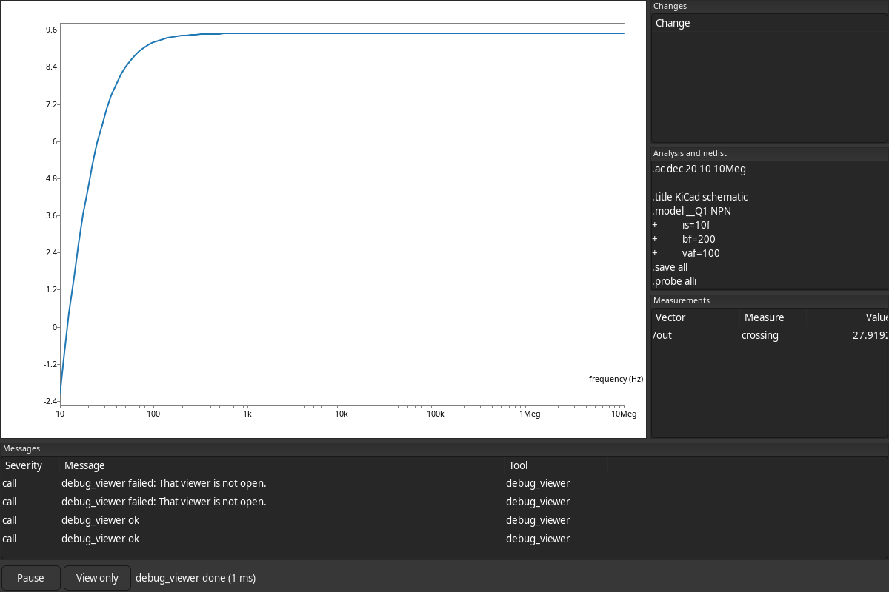

# Agentic KiCad

This fork of [KiCad](https://kicad.org) lets an AI agent design electronics with KiCad's own
engine. An MCP server runs inside KiCad, and every program is available to the agent as
structured tools (148 of them): schematics and hierarchy, symbol and footprint libraries,
boards with interactive routing, length tuning and zones, ERC and DRC, SPICE simulation, 3D,
Gerbers, drawing sheets, the calculator and footprint assignment. Any MCP client works,
for example Claude Code:

```bash
claude mcp add kicad -- /path/to/kicad-cli mcp --stdio      # headless
kicad --mcp-port 0                                          # with viewers; prints the URL and token
```

Every change is saved at once and is one step of the project's file history, so `undo`
and `redo` work across all programs. In viewer mode a person watches read-only viewers that
follow the agent (they never change the design) and can pause it. `kicad --classic` starts
KiCad's usual GUI. Fork code lives in `agentic/`; upstream files are touched only by small,
documented hooks, and the fork is off unless built with `-DKICAD_AGENTIC=ON`.

Documentation: [overview](doc/agentic/README.md), [connecting a client](doc/agentic/clients.md),
[tool reference](doc/agentic/tools.md), [upstream merges](doc/agentic/upstream-merge.md).

### The viewers

The pictures below come from one session in which an agent designed a 4-layer sensor board
and simulated its amplifier stage.

| | |
|---|---|
|  |  |
| **Hub**: open projects, their files, every call the agent makes, a button per viewer and Pause. | **Schematic**: follows the sheet the agent edits and highlights the change; hierarchy, ERC and nets beside it. |
|  |  |
| **PCB**: the board as the agent routes it, with layers, unrouted connections and DRC results. | **3D**: reloads after each board change and uses the camera the agent sets. |
|  |  |
| **Symbol editor**: the symbol the agent builds or inspects, unit by unit, with its pins. | **Footprint editor**: the footprint being built, with its pads. |
|  | |
| **Simulator**: the signals and measurements of the last ngspice run, with the netlist. | |

---

# KiCad README

For specific documentation about [building KiCad](https://dev-docs.kicad.org/en/build/), policies
and guidelines, and source code documentation see the
[Developer Documentation](https://dev-docs.kicad.org) website.

You may also take a look into the [Wiki](https://gitlab.com/kicad/code/kicad/-/wikis/home),
the [contribution guide](https://dev-docs.kicad.org/en/contribute/).

For general information about KiCad and information about contributing to the documentation and
libraries, see our [Website](https://kicad.org/) and our [Forum](https://forum.kicad.info/).

## Build state

KiCad uses a host of CI resources.

GitLab CI pipeline status can be viewed for Linux and Windows builds of the latest commits.

## Release status
[](https://repology.org/project/kicad/versions)
[](https://repology.org/metapackage/kicad/versions)

## Files
* [AUTHORS.txt](AUTHORS.txt) - The authors, contributors, document writers and translators list
* [CMakeLists.txt](CMakeLists.txt) - Main CMAKE build tool script
* [copyright.h](copyright.h) - A very short copy of the GNU General Public License to be included in new source files
* [Doxyfile](Doxyfile) - Doxygen config file for KiCad
* [INSTALL.txt](INSTALL.txt) - The release (binary) installation instructions
* [uncrustify.cfg](uncrustify.cfg) - Uncrustify config file for uncrustify sources formatting tool
* [_clang-format](_clang-format) - clang config file for clang-format sources formatting tool

## Subdirectories

* [3d-viewer](3d-viewer)         - Sourcecode of the 3D viewer
* [cmake](cmake)      - Modules for the CMAKE build tool
* [common](common)            - Sourcecode of the common library
* [cvpcb](cvpcb)             - Sourcecode of the CvPCB tool
* [demos](demos)             - Some demo examples
* [doxygen](doxygen)     - Configuration for generating pretty doxygen manual of the codebase
* [eeschema](eeschema)          - Sourcecode of the schematic editor
* [gerbview](gerbview)          - Sourcecode of the gerber viewer
* [include](include)           - Interfaces to the common library
* [kicad](kicad)             - Sourcecode of the project manager
* [libs](libs)           - Sourcecode of KiCad utilities (geometry and others)
* [pagelayout_editor](pagelayout_editor) - Sourcecode of the pagelayout editor
* [patches](patches)           - Collection of patches for external dependencies
* [pcbnew](pcbnew)           - Sourcecode of the printed circuit board editor
* [plugins](plugins)           - Sourcecode for the 3D viewer plugins
* [qa](qa)                - Unit testing framework for KiCad
* [resources](resources)         - Packaging resources such as bitmaps and operating system specific files
    - [bitmaps_png](resources/bitmaps_png)       - Menu and program icons
    - [project_template](resources/project_template)          - Project template
* [thirdparty](thirdparty)           - Sourcecode of external libraries used in KiCad but not written by the KiCad team
* [tools](tools)             - Helpers for developing, testing and building
* [translation](translation) - Translation data files (managed through [Weblate](https://hosted.weblate.org/projects/kicad/master-source/) for most languages)
* [utils](utils)             - Small utils for KiCad, e.g. IDF, STEP, and OGL tools and converters
